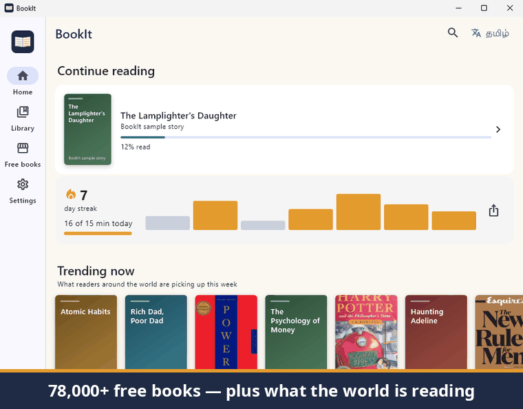
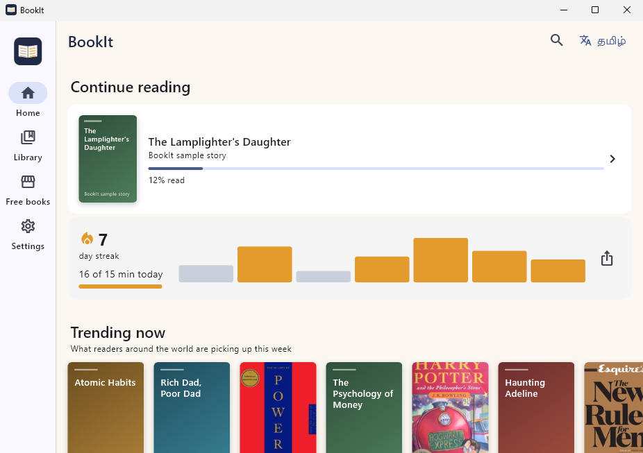
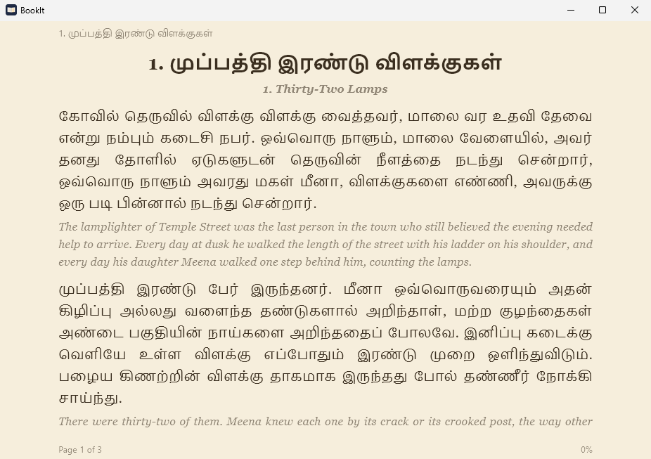
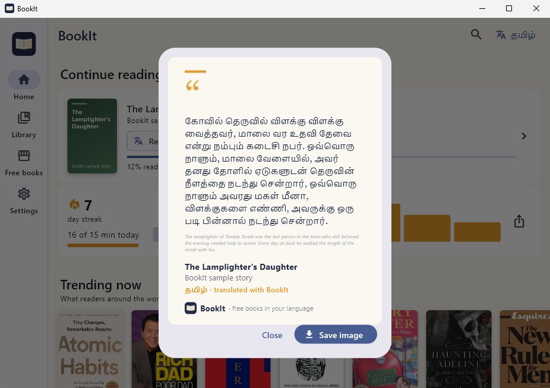

<p align="center"></p>

<h1 align="center">BookIt</h1>

<p align="center"><b>Read any book in your own language — free, offline, on your phone or PC.</b><br>
A Kindle-style e-reader that translates whole books into Hindi, Tamil, Bengali, Telugu, Marathi and 200 languages, right on your device.</p>

<p align="center">
  <a href="https://github.com/MohammedAnasAsif/BookIt/releases/latest"></a>
  <a href="https://github.com/MohammedAnasAsif/BookIt/releases"></a>
  <a href="https://github.com/MohammedAnasAsif/BookIt/stargazers"></a>
  <br>
  
  <a href="https://github.com/MohammedAnasAsif/BookIt/actions/workflows/build.yml"></a>
  <a href="LICENSE"></a>
</p>

<p align="center"></p>

<p align="center"><b>⭐ If BookIt helps you or someone you know read more, please star the repo — it's how other readers find it.</b></p>

---

BookIt is a reading app with a built-in library of 78,000+ free books. Pick any book, tap **Translate**, choose your language, and BookIt translates the whole book **on your phone or PC** and keeps it. After that you can read it anytime, without internet. It can also read the book aloud to you.

No accounts, no API keys, no subscriptions, no ads. Nothing you read is sent anywhere.

## Why BookIt?

| | **BookIt** | Most e-reader apps |
| --- | :---: | :---: |
| Translate a **whole book** into Tamil, Hindi, Bengali… | ✅ on your device | ❌ a word or sentence at a time, online |
| Read the translation **offline**, forever | ✅ | ❌ |
| 78,000+ free books built in, plus trending picks | ✅ | some |
| **Bilingual view** — original under each translated paragraph | ✅ | ❌ |
| **Read aloud** in the book's language | ✅ device voices | some |
| Menus in Hindi, Tamil, Bengali, Telugu, Marathi | ✅ | rarely |
| Account, ads or tracking | ❌ none | usually |
| Price | **Free & open source** | free app, paid books |

| Home | Bilingual reading (Tamil + English) | Share a passage |
| --- | --- | --- |
|  |  |  |

<sub>Screenshots are taken automatically by CI from the real Windows build. The Tamil text is BookIt's sample story, translated on the machine by the app itself.</sub>

## Download

Go to **[Releases](https://github.com/MohammedAnasAsif/BookIt/releases)**:

| Platform | File |
| --- | --- |
| Android (most phones) | `BookIt-android-arm64.apk` |
| Android (any phone) | `BookIt-android.apk` |
| Windows 10/11 installer | `BookIt-Setup-x.y.z.exe` |
| Windows portable | `BookIt-windows-x64.zip` — unzip and run `bookit.exe` |

The `latest` pre-release is rebuilt automatically from the newest code.

> On Android you may need to allow "Install unknown apps" for your browser or file manager the first time.

## Features

- **Free library** — the whole Project Gutenberg catalog (78,000+ public-domain books) is built into the app, so browsing and search by shelf (Indian, novels, adventure, children, poetry…) and language are instant, even offline. One tap opens a book.
- **Ready-made translations** — popular classics (Alice in Wonderland, The Jungle Book, Gitanjali, Sherlock Holmes, Pride and Prejudice and more) already translated into Hindi, Tamil, Bengali, Telugu and Marathi. Download and read in seconds.
- **Trending now & bestsellers** — see what readers everywhere are picking up this week (from Open Library) and popular modern books, with links to buy them or borrow them from a library.
- **Free modern fiction** — novels their authors chose to share under Creative Commons licences, e.g. Cory Doctorow's *Little Brother*.
- **Beautiful classics** — 1,500+ carefully edited public-domain books from [Standard Ebooks](https://standardebooks.org).
- **Your own books** — open DRM-free EPUB and TXT files, or `.bookit` editions shared by others.
- **Kindle-style reader** — real pages with tap zones and swipes, fonts, text size, spacing, margins, white / sepia / gray / dark / black themes, chapter slider, contents, bookmarks, progress. Keyboard and mouse-wheel page turns on Windows.
- **Translate any book** — into 200 languages including Hindi, Bengali, Telugu, Marathi, Tamil, Urdu, Gujarati, Kannada, Malayalam, Odia, Punjabi, Assamese, Maithili, Sanskrit, Nepali, Sindhi, Kashmiri, Manipuri, Santali, and most European and world languages.
- **Start reading right away** — the chapter you are reading is translated first; untranslated paragraphs show in lighter text and switch over as they are ready.
- **Bilingual view** — show the original under each translated paragraph. Great for learning a language.
- **Read aloud** — BookIt reads the page to you in the book's language using your device's voices and turns pages by itself.
- **Reading streaks** — daily goal, streak and a weekly chart on Home. Share your reading week as an image.
- **Share a quote** — long-press a page to turn a passage (with its original) into a beautiful image for WhatsApp or Instagram.
- **Menus in your language** — English, हिन्दी, বাংলা, தமிழ், తెలుగు, मराठी.
- **Share translations** — save any translation as an EPUB for other e-readers, or as a `.bookit` edition for the community library.

## How translation works

BookIt runs Meta AI's **NLLB-200** translation model (distilled 600M, 8-bit) with ONNX Runtime directly on your device.

1. The first time you translate, BookIt downloads the model once (about **1.35 GB** — use Wi-Fi).
2. The book is split into sentences and translated in batches in the background, starting from the chapter you are reading.
3. Each translated paragraph is saved next to the book, so the translation is available offline forever.

**Speed:** a phone translates a full novel in a few hours (keep BookIt open — it keeps the screen awake while translating); a PC is several times faster. You can read the first chapters within minutes.
**Quality:** machine translation is good for understanding and enjoying a story but is not perfect. The community library can use larger, more accurate models (see below).
**Memory:** the model needs roughly 1.5 GB of free RAM; phones with 6 GB or more work best.

The tokenizer and decoding were verified against the reference Python implementation (100% identical tokens on a full novel; see `.github/workflows/engine.yml`).

## Community library (pre-translated books)

Translating takes time, so translations can be shared. Editions listed in [`catalog/editions.json`](catalog/editions.json) appear in the app under *Ready to read in your language*.

To contribute a translation of a **public-domain** book:

1. Translate it — either in the BookIt app (Book → ⋮ → *Share as BookIt edition*), or on a PC with
   [`tools/translate_book.py`](tools/translate_book.py), which can use larger models
   (NLLB-200 1.3B, or AI4Bharat's IndicTrans2 for Indian languages):
   ```bash
   pip install torch transformers sentencepiece beautifulsoup4 lxml
   python tools/translate_book.py --gutenberg 1342 --to tam_Taml
   ```
2. Open an issue or pull request with the `.bookit` file and the catalog entry the tool prints. Maintainers attach the file to the `editions` release and add the entry.

Please only share books that are in the public domain (like Project Gutenberg books) or that you have the rights to share.

## Build from source

Requirements: [Flutter](https://docs.flutter.dev/get-started/install) (stable channel). Android builds need the Android SDK; Windows builds need Visual Studio with the "Desktop development with C++" workload.

```bash
cd app
flutter pub get
flutter run                     # on a connected phone or this PC
flutter build apk --release     # Android
flutter build windows --release # Windows
flutter test                    # unit tests
```

Every push to `main` is built by GitHub Actions ([`.github/workflows/build.yml`](.github/workflows/build.yml)): analysis and tests, Android APKs, a Windows zip and installer, and the `latest` pre-release. Tags like `v0.2.0` publish a normal release.

**Release signing:** add two repository secrets — `ANDROID_KEYSTORE_BASE64` (the base64 of a `.jks` keystore with key alias `bookit`) and `ANDROID_KEYSTORE_PASSWORD`. Without them, APKs are signed with a temporary debug key and can't be installed as updates over each other.

### Project layout

```
app/                         Flutter app (Android + Windows)
  lib/books/                 EPUB/TXT parsing, EPUB writer, .bookit editions
  lib/data/                  library storage, bundled Gutenberg catalog, settings
  lib/translation/engine/    NLLB tokenizer (pure Dart), ONNX Runtime model, sentence splitting
  lib/translation/           background translation worker and job queue
  lib/ui/                    screens; lib/ui/reader/ is the paginated reader
catalog/editions.json        community library index
tools/build_catalog.py       builds the bundled Gutenberg catalog and featured shelves
tools/build_discover.py      builds the weekly Discover shelves (catalog/discover.json)
tools/translate_book.py      batch translation for the community library
tools/engine_reference.py    reference data for the engine test
.github/workflows/           builds, engine test, developer probes
```

## Roadmap

- Android foreground service so translation continues with the app in the background
- Optional higher-quality packs (IndicTrans2 for Indian languages; larger NLLB models on PCs)
- PDF import, highlights and notes, dictionary lookup
- More pre-translated books and more menu languages (Kannada, Malayalam, Gujarati, Urdu…) — help wanted!

Contributions are welcome — see [CONTRIBUTING.md](CONTRIBUTING.md). Translating the app's menus into your language is a great first contribution: copy `app/lib/l10n/hi.dart`, translate the right-hand side, and open a pull request.

<p align="center"><b>⭐ Star BookIt</b> to help more people read in their own language.</p>

## Credits and licences

- BookIt code: [Apache License 2.0](LICENSE).
- Books and catalog: [Project Gutenberg](https://www.gutenberg.org) (the bundled catalog is rebuilt monthly from Gutenberg's official catalog by [`tools/build_catalog.py`](tools/build_catalog.py)). Gutenberg books are free and in the public domain in the USA; please check the laws of your country.
- Discover shelves: book details and covers from [Open Library](https://openlibrary.org); classics from [Standard Ebooks](https://standardebooks.org) (please consider [supporting them](https://standardebooks.org/donate)); free modern novels mirrored with credit under their authors' Creative Commons licences.
- Translation model: [NLLB-200](https://ai.meta.com/research/no-language-left-behind/) by Meta AI, licensed **CC-BY-NC 4.0** (free for non-commercial use), using the ONNX export by [Xenova](https://huggingface.co/Xenova/nllb-200-distilled-600M). Because of this licence, BookIt as distributed is for non-commercial use.
- [ONNX Runtime](https://onnxruntime.ai) (MIT) via the [`onnxruntime`](https://pub.dev/packages/onnxruntime) Flutter plugin.
- Optional tooling: [IndicTrans2](https://github.com/AI4Bharat/IndicTrans2) by AI4Bharat (MIT).
